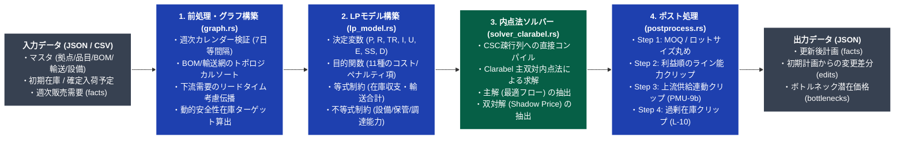

# scm-lp-optimizer

**Pure-Rust Multi-Period Capacitated Linear Programming (LP) Supply Chain Optimizer**  
マルチ期間・能力制約付きサプライチェーン計画（S&OP / 需給計画 / 多段階MRP展開）のための、Pure Rust 製・線形計画（LP）最適化エンジンおよびマイクロサービスです。

---

## 目次 (Table of Contents)

1. [想定利用シーンと想定効果 (Target Use Cases & Expected Impact)](#1-想定利用シーンと想定効果-target-use-cases--expected-impact)
2. [概要と特徴 (Overview & Key Features)](#2-概要と特徴-overview--key-features)
3. [システムアーキテクチャと処理パイプライン (Architecture & Pipeline)](#3-システムアーキテクチャと処理パイプライン-architecture--pipeline)
4. [対象とするサプライチェーンネットワーク (Supply Chain Network Model)](#4-対象とするサプライチェーンネットワーク-supply-chain-network-model)
5. [数理最適化モデルの概要 (Mathematical Formulation Summary)](#5-数理最適化モデルの概要-mathematical-formulation-summary)
6. [実務制約を満たす4段階ポスト処理 (Post-Processing Pipeline)](#6-実務制約を満たす4段階ポスト処理-post-processing-pipeline)
7. [入出力データ仕様サマリ (Input / Output Schema)](#7-入出力データ仕様サマリ-input--output-schema)
8. [サンプルデータによる動作ウォークスルー (End-to-End Walkthrough)](#8-サンプルデータによる動作ウォークスルー-end-to-end-walkthrough)
9. [クイックスタート・実行方法 (Quick Start & Usage)](#9-クイックスタート実行方法-quick-start--usage)
10. [Google Cloud Run デプロイと Python 連携 (Cloud Run & Python Integration)](#10-google-cloud-run-デプロイと-python-連携-cloud-run--python-integration)
11. [ディレクトリ構成と詳細ドキュメント (Repository Structure & Docs)](#11-ディレクトリ構成と詳細ドキュメント-repository-structure--docs)

---

## 1. 想定利用シーンと想定効果 (Target Use Cases & Expected Impact)

### 1.1 想定利用シーン (Target Use Cases)

本エンジンは、製造業・流通業・小売業における以下のようなサプライチェーン計画業務およびシステム基盤のコアエンジンとして利用することを想定しています。

1. **週次 S&OP（Sales & Operations Planning / 生販在計画）における高速 What-If シミュレーション**
   * 需要の上振れ・下振れ、特定工場の定期修繕・突発設備停止、原材料の調達制約などが発生した際、複数のシナリオ（需要ケース × 設備能力ケース × 安全在庫方針）をリアルタイム（数ミリ秒〜数十ミリ秒）で再計算し、会議の場で即座に比較・意思決定を行うシーン。
2. **無制限 MRP（資材所要量計画）から能力制約付き計画（Finite Capacity Planning）への高度化**
   * 既存の ERP / MRP システムが出力する「設備能力や倉庫容量を考慮しない山積み要求量（無制約計画）」に対し、製造ラインの週間稼働時間上限、複数工場・複数サプライヤーへの発注配分（クォータ）、最小ロット（MOQ）・刻みロットを考慮した**実行可能な生産・補充・調達計画**へ自動変換するシーン。
3. **複数階層ネットワーク（工場 ➔ 中央倉庫 ➔ 地域DC）の在庫配置・補充計画の全体最適化**
   * 各拠点が個別に発注判断を行うことによるブルウィップ効果や拠点間の在庫偏在（あるDCでは欠品し、別のDCや工場では過剰在庫になる事象）を防ぎ、輸送リードタイム・製造リードタイム・品目別利益率（マージン）を踏まえたネットワーク全体の最適配分を算出するシーン。
4. **設備投資・残業・外注判断のためのボトルネック定量評価（Shadow Price 分析）**
   * 計画期間を通じて「どの工場・どのライン・どの週の能力が全体の供給を律速しているか」を特定し、双対変数（潜在価格: `marginal_value`）を用いて「その週のライン稼働時間を1時間増強（残業・休日出勤・外注化）すれば、欠品回避やコスト削減によって全体利益がいくら改善するか」を定量的に評価するシーン。
5. **既存の Python 製 SCM Web アプリケーションやデータパイプラインへのソルバー組み込み**
   * Streamlit / FastAPI / Django 等の Python アプリケーションや夜間バッチ処理から、C/C++ 共有ライブラリの環境依存問題や商用ソルバーの高額なライセンス制約を受けることなく、ステートレスな Cloud Run マイクロサービスまたは単一 CLI バイナリとして呼び出すシーン。

### 1.2 想定効果 (Expected Business & System Impact)

| 観点 | 従来の課題（Excel 手作業 / 無制約 MRP / Python+外部ソルバー） | `scm-lp-optimizer` 導入による想定効果 |
| :--- | :--- | :--- |
| **計画立案リードタイムと試行回数** | 週次計画の調整・山崩しに数時間〜数日を要し、1サイクルで1〜2パターンの検証が限界。 | 中規模ネットワークで **1ミリ秒〜数十ミリ秒** で求解完了。対話的なUI上でのリアルタイム再計算や、数百パターンのパラメトリックな一括 What-If シミュレーションが可能。 |
| **欠品削減と在庫適正化の両立** | 欠品を防ぐために一律に過大な安全在庫を持つか、逆に能力不足を見落として直前で欠品が発生。 | 需要伝播に基づく動的安全性在庫ターゲットと多段階リードタイムを厳密に同期。高収益品目への優先能力割当により、**欠品（機会損失）の最小化と過剰在庫の抑制**を同時に達成。 |
| **現場実行可能性（ロット・能力整合）** | LP の連続解（小数）をそのまま現場に出せず、丸めると設備能力超過や上流部品不足が発生。 | 4段階ポスト処理（MOQ/刻みロット丸め ➔ 利益順の能力クリップ ➔ 上流供給連動クリップ ➔ 過剰在庫クリップ）により、**そのまま発注・製造指示に使える整数ロット計画**を出力。 |
| **ボトルネック可視化と意思決定の迅速化** | どこが真のボトルネックか担当者の経験と勘に依存し、残業・外注判断の投資対効果が不明確。 | 内点法の双対解（Shadow Price）を自動抽出し、**設備・倉庫・週ごとの「能力1単位あたりの限界価値」を数値化**。客観的根拠に基づく迅速な能力増強判断を実現。 |
| **システム運用・インフラ保守性** | Python 環境での CBC / GLPK / HiGHS 等のネイティブ依存エラー、プロセス起動の遅さ、コンテナ肥大化。 | **Pure Rust (`clarabel`) による単一静的バイナリ & 軽量コンテナ**。OS 依存の共有ライブラリが一切不要で、Google Cloud Run 等のサーバーレス環境でコールドスタート・メモリ消費ともに極小化。 |

---

## 2. 概要と特徴 (Overview & Key Features)

`scm-lp-optimizer` は、サプライヤー・製造工場・配送センター（DC）など複数の拠点にまたがる多段階サプライチェーンにおいて、**需要を満たしつつ、製造能力・倉庫保管能力・輸送リードタイム・BOM（部品表）・安全在庫目標・ロットサイズ制約を同時に考慮した最適需給計画（生産計画・補充輸送計画・調達発注計画）** を高速に算出する汎用エンジンです。

### 主な特徴

* **Pure Rust 実装 & C/C++ ネイティブ依存ゼロ**:
  * コアの線形計画ソルバーとして、オックスフォード大学制御グループ等で開発された Pure Rust の主双対内点法（Primal-Dual Interior Point Method）ソルバー [`clarabel`](https://crates.io/crates/clarabel) を採用しています。
  * 従来の Python + PuLP / CBC / GLPK / HiGHS のように OS 固有の C/C++ 共有ライブラリや外部ソルバーバイナリをインストールする必要がなく、単一の静的リンクバイナリまたは軽量コンテナとしてどこでも同一に動作します。
* **圧倒的な計算速度（サブミリ秒〜数十ミリ秒）**:
  * 疎行列（CSC: Compressed Sparse Column）を Rust のメモリ上で直接構築し、プロセス起動や Python オブジェクト生成のオーバーヘッドなしに求解します。中規模ネットワークであれば **1ミリ秒未満〜数ミリ秒** で最適解に到達します。
* **2つの実行インターフェースを標準同梱**:
  1. **スタンドアロン CLI (`scm-lp-cli`)**: ファイルまたは標準入力（`stdin`）から JSON を受け取り、最適化結果をファイルまたは標準出力（`stdout`）へ返却します。バッチ処理やデータパイプラインへの組み込みに最適です。
  2. **ステートレス HTTP REST API サーバー (`scm-lp-server`)**: Google Cloud Run、AWS App Runner、Kubernetes 等のコンテナ環境向けに設計された Web API サーバー（`GET /health`, `POST /optimize`）です。
* **双対変数（Shadow Price / 潜在価格）によるボトルネック自動診断**:
  * 内点法の双対解（Dual Variables）から、製造ライン能力・倉庫保管能力・輸送ルート上限などの制約のうち「どの拠点の・どの設備の・どの週の能力が計画全体のボトルネックになっているか」および「その能力を1単位増強すると全体コスト（または利益）がいくら改善するか（限界価値: `marginal_value`）」を自動抽出します。
* **LP連続緩和と実務ロット・能力制約の両立**:
  * 整数計画法（MIP）特有の計算時間爆発を避けるため、コアは連続LPとして高速に大域的最適フローを解き、直後の決定論的ポスト処理パイプラインで最小ロット（MOQ）・刻みロット（Lot Size）・利益優先度順の能力クリッピング・上下流の供給整合（PMU-9b）を厳密に保証します。

---

## 3. システムアーキテクチャと処理パイプライン (Architecture & Pipeline)

本エンジンは、入力された JSON（または CSV から変換された JSON）に対し、以下の **4段階のパイプライン** を経て最適計画と変更差分（`edits`）およびボトルネック情報（`bottlenecks`）を生成します。



---

## 4. 対象とするサプライチェーンネットワーク (Supply Chain Network Model)

本エンジンは、任意の拠点階層（サプライヤー ➔ 部品工場 ➔ 組立工場 ➔ 中央倉庫 ➔ 地域DC など）および多段階 BOM を表現できます。以下は同梱サンプル（[`examples/basic_2echelon_request.json`](examples/basic_2echelon_request.json)）のネットワーク構造です。

```mermaid
flowchart LR
    classDef supplier fill:#374151,stroke:#ffffff,stroke-width:2px,color:#ffffff;
    classDef plant fill:#1e3a8a,stroke:#ffffff,stroke-width:2px,color:#ffffff;
    classDef dc fill:#065f46,stroke:#ffffff,stroke-width:2px,color:#ffffff;
    classDef customer fill:#7f1d1d,stroke:#ffffff,stroke-width:2px,color:#ffffff;

    SUP["<div style='color:#ffffff;'><b>外部サプライヤー</b><br/>原材料供給元<br/>(can_procure = true)</div>"]:::supplier

    subgraph PLANT_SUB["工場拠点: PLANT-A"]
        RAW["<div style='color:#ffffff;'><b>原材料: RAW-1</b><br/>初期在庫: 100<br/>調達単価: 10.0</div>"]:::plant
        LINE["<div style='color:#ffffff;'><b>製造ライン: LINE-FG</b><br/>BOM: RAW-1 × 2.0 ➔ FG-1 × 1.0<br/>生産レート: 10.0 個/時 (40h/週)</div>"]:::plant
        FG_P["<div style='color:#ffffff;'><b>完成品: FG-1 (工場在庫)</b><br/>初期在庫: 50 / 製造LT: 0週<br/>製造原価: 30.0</div>"]:::plant
    end

    subgraph DC_SUB["配送センター拠点: DC-EAST"]
        FG_DC["<div style='color:#ffffff;'><b>完成品: FG-1 (DC在庫)</b><br/>初期在庫: 80 / Week1確定入荷: 20<br/>安全在庫基準: 0.5週分</div>"]:::dc
    end

    CUST["<div style='color:#ffffff;'><b>顧客・市場需要 (sales_qty)</b><br/>W1: 0 / W2: 100<br/>W3: 150 / W4: 120</div>"]:::customer

    SUP -->|"調達補充 R (調達LT: 0週)"| RAW
    RAW -->|"従属需要 (BOM 2:1)"| LINE
    LINE -->|"生産完了 P"| FG_P
    FG_P -->|"拠点間輸送 TR (輸送LT: 1週 / 輸送費: 2.0)"| FG_DC
    FG_DC -->|"販売出荷 (売価: 120.0)"| CUST
```



---

## 5. 数理最適化モデルの概要 (Mathematical Formulation Summary)

詳細な数式定義は [`docs/mathematical_formulation.md`](docs/mathematical_formulation.md) を参照してください。ここではモデルの中核構造を解説します。

### 5.1 主な決定変数（各拠点 $l$・品目 $s$・週 $t \in \{0, \dots, T-1\}$）

すべての決定変数は非負連続変数（$\ge 0$）として定義されます。

| 変数記号 | プログラム内名称 | 意味・役割 |
| :--- | :--- | :--- |
| $P_{l,s,t}$ | `P` | 週 $t$ に拠点 $l$ で生産完了（入庫）する品目 $s$ の生産量 |
| $R_{l,s,t}$ | `R` | 週 $t$ に拠点 $l$ へ到着（入庫）する品目 $s$ の補充量（輸送入荷＋外部調達入荷の合計） |
| $TR_{r,t}$ | `TR` | 輸送ルート $r=(u \to l, s)$ において週 $t$ に下流拠点 $l$ へ到着する輸送量（上流 $u$ からは週 $t - LT_r$ に出荷） |
| $I_{l,s,t}$ | `I` | 週 $t$ 末時点における拠点 $l$・品目 $s$ の期末在庫量 |
| $U_{l,s,t}$ | `U` | 週 $t$ における欠品量（Unfulfilled Demand / Shortage） |
| $E_{l,s,t}$ | `E` | 週 $t$ 末における有効在庫上限を超過した過剰在庫量（Excess Inventory） |
| $SS_{l,s,t}$ | `SS` | 週 $t$ 末における目標安全在庫に対する不足量（Safety Stock Deficit） |
| $D^P_{l,s,t}, D^R_{l,s,t}$ | `DP`, `DR` | 前週（$t-1$）からの生産量・補充量の絶対変動量（計画平準化ペナルティ用補助変数） |
| $U^{\text{bo}}_{l,s,t}$ | `U_bo` | 期首バックオーダー（過去未納分）のうち週 $t$ 末時点で未解消の残高 |
| $UF_{r,t}$ | `UF` | 輸送ルート $r$ における上流在庫不足スラック（ファントム輸送防止ペナルティ用） |

### 5.2 目的関数（最小化）

LPソルバーは以下の総コスト関数 $Z$ を最小化します（利益考慮モード `enable_margin_Sort = true` の場合は、限界利益 $(p - c)$ に応じて需要充足インセンティブが自動調整されます）：

$$
\min Z = \sum_{l,s,t} \Big(
  w_{\text{short}} U_{l,s,t}
  + w_{\text{bo}} U^{\text{bo}}_{l,s,t}
  + w_{\text{ss}} SS_{l,s,t}
  + h_{l,s} I_{l,s,t}
  + w_{\text{excess}} E_{l,s,t}
  + c^{\text{prod}}_{l,s} P_{l,s,t}
  + c^{\text{proc}}_{l,s} R_{l,s,t}
  + w_{\text{smooth}} (D^P_{l,s,t} + D^R_{l,s,t})
\Big) + \sum_{r,t} \Big( c^{\text{trans}}_r TR_{r,t} + w_{\text{uf}} UF_{r,t} \Big)
$$

* **優先順位の階層設計（重み付け）**:
  1. **需要欠品の回避 (`shortage_penalty` = 既定 `1000.0`)** および **期首バックオーダー解消 (`backorder_penalty` = 既定 `2000.0`)** が最優先されます。
  2. 次に **安全在庫目標の維持 (`safety_stock_penalty` = 既定 `100.0`)** が優先されます。
  3. その上で、**製造原価・調達単価・輸送コスト・在庫保管費 (`holding_cost`)・過剰在庫ペナルティ (`excess_inventory_penalty`)・週次変動ペナルティ (`smoothing_penalty`)** の総和が最小となる生産・輸送・調達タイミングが選択されます。
  4. 最終週（$t = T-1$）の期末在庫には `terminal_inventory_penalty_weight` が加算され、計画期間末に不要な在庫を積み上げる挙動を防止します。

### 5.3 主要な制約条件

1. **多段階在庫バランス等式（物質収支）**:
   * 各拠点・品目・週において、「期首在庫（または前週期末在庫）＋ 当週生産入庫 $P_{l,s,t}$ ＋ 当週補充入庫 $R_{l,s,t}$ ＋ 確定入荷予定 $SR_{l,s,t}$ ＋ 欠品スラック $U_{l,s,t}$ ＝ 外部販売需要 $Dem_{l,s,t}$ ＋ BOM従属需要（親品目の生産に伴う消費量）＋ 下流拠点への輸送出荷量 ＋ 当週期末在庫 $I_{l,s,t}$」を厳密に満たします。
   * **製造リードタイム ($LT^{\text{prod}}$)・歩留まり (`yield_rate`: $\eta$)・スクラップ率 (`scrap_rate`: $s$)**: 親品目 $p$ が週 $t + LT^{\text{prod}}$ に完成するためには、週 $t$ に着手が必要であり、その時点で子品目 $c$（基準員数 `quantity`: $q$）が $\frac{q}{\eta \times (1 - s)}$ だけ消費されます。
2. **輸送ルート整合性と配分比率（Quota）制約**:
   * 下流拠点への輸送補充 $R_{l,s,t}$ は、各上流拠点からの到着輸送量 $\sum_r TR_{r,t}$ と一致します。
   * 複数の輸送ルートに `quota_pct`（配分比率）が設定されている場合、指定された比率に従って調達先を按分します。
3. **製造ライン能力制約（時間ベース / 数量ベース両対応）**:
   * 製造ライン $(l, \text{line})$（`line_id`）に週間稼働可能時間 `available_hours_per_week` ($H^{\text{avail}}_{l,\text{line},t}$) と BOM の時間あたり生産レート `rate_per_hour` ($r_s$) が設定されている場合は **時間ベース能力制約**（$\sum_s \frac{P_{l,s,t}}{r_s \cdot \eta_s} \le H^{\text{avail}}_{l,\text{line},t}$）を適用し、未設定の場合は **数量ベース能力制約**（$\sum_s P_{l,s,t} \le C^{\max}_{l,\text{line},t}$、`max_capacity`）を適用します。
   * 週別のカレンダー能力変更（定期修繕や休日稼働など）は `capacity_overrides` で週単位に上書き可能です。
4. **倉庫保管能力制約 (`max_storage_capacity`) & 週間調達能力制約 (`weekly_procurement_capacity`)**:
   * 拠点全体の期末在庫合計 $\sum_s I_{l,s,t} \le C^{\text{stor}}_l$（`max_storage_capacity`）、およびサプライヤーからの週間発注上限を遵守します。
5. **確定期間フェンス（Frozen Fence）**:
   * `production_fence_weeks` や `replenishment_fence_weeks` で指定された直近の数週間については、計画値を既存の入力値に固定し、直近の現場確定計画が勝手に変更されるのを防ぎます。

---

## 6. 実務制約を満たす4段階ポスト処理 (Post-Processing Pipeline)

内点法ソルバーが出力した連続最適解（小数を含む実数値）を、現場でそのまま実行可能な整数ロット計画へ変換するため、[`src/postprocess.rs`](src/postprocess.rs) において以下の4段階のポスト処理を順次実行します。

| ステップ | 処理名称 | 処理内容の詳細 |
| :--- | :--- | :--- |
| **Step 1** | **最小ロット（MOQ）・刻みロット丸め** | 生産量 $P$、輸送量 $TR$、調達量 $R$ に対し、微小な数値誤差（`< 1e-4`）をゼロに切り捨てた後、最小数量（`min_production_qty`, `min_shipping_qty`, `min_procurement_qty`）および刻みロット（`production_lot_size`, `shipping_lot_size`, `purchase_lot_size`）の整数倍へ切り上げます。 |
| **Step 2** | **利益優先度順の設備能力クリッピング** | ロット切り上げによって製造ライン能力を超過した場合、同一ライン上の品目を **単位あたり利益マージン（`price - cost`）の高い順** にソートし、高収益品目から優先的に能力枠を割り当て、超過分をロット単位で切り詰めます。 |
| **Step 3** | **上流供給可能量に連動した下流補充クリップ (`PMU-9b`)** | トポロジカル順序（上流 ➔ 下流）に従い、上流拠点の実在庫・実生産量（Step 2 クリップ後）から出荷可能な上限を再計算し、下流拠点の輸送入荷量が上流の供給可能量を超えないよう同期クリッピングを行います。 |
| **Step 4** | **有効在庫上限に基づく過剰生産クリップ (`L-10`)** | ロット丸めや固定入荷によって期末在庫が有効在庫上限（安全在庫 $\times$ `excess_inventory_buffer_ratio`）を超過する場合、不要な生産・補充を削減し、最終的な発注リリース量（`order_release_qty`）と計画要求量（`production_request`, `replenishment_request`）を確定します。 |

---

## 7. 入出力データ仕様サマリ (Input / Output Schema)

全フィールドの型・デフォルト値・業務上の意味については [`docs/data_dictionary.md`](docs/data_dictionary.md) に網羅されています。

### 7.1 リクエスト JSON (`OptimizeRequestPayload`) の構成要素

| トップレベルキー | 必須 | 説明 |
| :--- | :---: | :--- |
| `config` | 任意 | ソルバーの重み係数・動作フラグ（欠品ペナルティ、安全在庫ペナルティ、利益優先モード、デフォルト安全在庫週数など）。省略時は標準デフォルト値が適用されます。 |
| `facts` | **必須** | 拠点 (`location`) × 品目 (`sku`) × 週 (`week_start`: `YYYY-MM-DD`) ごとのトランザクションレコード。販売需要 (`sales_qty`) や既存の生産/補充計画値を保持します。**週次カレンダーは7日等間隔である必要があります。** |
| `item_locations` | 推奨 | 拠点×品目マスタ。外部調達可否 (`can_procure`)、製造LT (`production_lt`)、調達LT (`procurement_lt_weeks`)、各種最小ロット・刻みロット、売価 (`price`)、原価 (`cost`)、調達単価 (`procurement_unit_cost`) 等を定義します。 |
| `bom` | 任意 | 部品表マスタ。製造拠点 (`target_location`)、親品目 (`parent_sku`)、子品目 (`child_sku`)、構成員数 (`quantity`)、使用ライン (`line_id`)、時間あたり生産レート (`rate_per_hour`)、歩留まり (`yield_rate`)、スクラップ率 (`scrap_rate`) を定義します。 |
| `transport_routes` | 任意 | 拠点間輸送ルートマスタ。出荷元 (`from_location`)、入荷先 (`to_location`)、品目 (`sku`)、輸送LT (`transport_lt`)、単位輸送費 (`transport_cost_per_unit`)、輸送ロット、配分比率 (`quota_pct`) を定義します。 |
| `lines` | 任意 | 製造ライン能力マスタ。拠点 (`location`)、ラインID (`line_id`)、最大能力 (`max_capacity`)、週間稼働時間 (`available_hours_per_week`) を定義します。 |
| `locations` | 任意 | 拠点マスタ。単位保管コスト (`holding_cost`)、原価比例保管費率 (`holding_cost_rate`)、倉庫最大保管能力 (`max_storage_capacity`) を定義します。 |
| `init_inventory` | 任意 | 計画開始時点（Week 0 期首）の拠点×品目別初期在庫量 (`qty`)。 |
| `scheduled_receipts` | 任意 | すでに発注・出荷済みで、特定の週 (`due_week`) に到着予定の確定入荷レコード (`qty`)。 |
| `capacity_overrides` | 任意 | 特定の拠点・ライン・週における製造能力上限の一時変更（カレンダー例外）。 |
| `backorder_skus` | 任意 | 計画開始時点で未納となっている期首バックオーダー残高。 |

### 7.2 レスポンス JSON (`OptimizeResponsePayload`) の構成要素

| トップレベルキー | 型 | 説明 |
| :--- | :--- | :--- |
| `status` | `String` | 求解ステータス（`"optimal"`: 最適解到達、`"almost_optimal"`: 準最適解到達）。エラー時は HTTP 400 とともに `"error"` を返却。 |
| `elapsed_ms` | `u128` | 前処理からポスト処理完了までの総実行時間（ミリ秒）。 |
| `facts` | `Array` | 入力された `facts` 全行に対し、最適化後の `production_qty`（生産入庫量）、`replenishment_qty`（補充入庫量）、`production_request`（製造着手指示量）、`replenishment_request`（補充出荷指示量）、`order_release_qty`（外部発注指示量）を反映した完全な計画テーブル。 |
| `edits` | `Array` | 入力時の `facts` から値が変化したセルのみを抽出した差分リスト。呼び出し側システム（DBやUI）での差分更新（Delta Update）に利用できます。 |
| `bottlenecks` | `Array` | 能力上限に達して計画を制約している設備・倉庫・週のリスト。`description`（制約の名称）と `marginal_value`（双対変数＝能力を1単位増やした際の目的関数改善額）を含みます。 |

---

## 8. サンプルデータによる動作ウォークスルー (End-to-End Walkthrough)

同梱されている [`examples/basic_2echelon_request.json`](examples/basic_2echelon_request.json)（および [`templates/csv/`](templates/csv/)）を実際に実行した際の入出力結果です。

### 8.1 シナリオ設定
* **拠点と品目**:
  * 工場 `PLANT-A` で原材料 `RAW-1`（初期在庫 `100`、外部調達LT `0週`）を調達し、生産ライン `LINE-FG` で完成品 `FG-1`（初期在庫 `50`、製造LT `0週`、BOM: `FG-1` 1個につき `RAW-1` 2個消費）を生産。
  * 配送センター `DC-EAST`（初期在庫 `80`、Week 1 に確定入荷 `20` あり、安全在庫目標 `0.5週分`）へ、`PLANT-A` から輸送リードタイム **1週間** で `FG-1` を補充輸送。
* **DC-EAST における完成品 `FG-1` の週次販売需要**:
  * Week 1 (`2026-01-05`): `0`
  * Week 2 (`2026-01-12`): `100`
  * Week 3 (`2026-01-19`): `150`
  * Week 4 (`2026-01-26`): `120`

### 8.2 通常能力下での最適化結果（計算時間: `0 ms`）

| 拠点 | 品目 | 週 (`week_start`) | 販売需要 | 生産量 (`production_qty`) | 補充入荷量 (`replenishment_qty`) | 発注リリース (`order_release_qty`) | 数理モデルの動き（物質収支とLTシフト） |
| :--- | :--- | :--- | ---: | ---: | ---: | ---: | :--- |
| **`DC-EAST`** | `FG-1` | `2026-01-05` | 0 | 0 | 0 | 0 | 初期在庫 80 ＋ 確定入荷 20 ＝ 期末在庫 100 |
| **`DC-EAST`** | `FG-1` | `2026-01-12` | 100 | 0 | **130** | 0 | 需要 100 を満たしつつ次週安全在庫を確保するため 130 入荷 |
| **`DC-EAST`** | `FG-1` | `2026-01-19` | 150 | 0 | **140** | 0 | 需要 150 に対し 140 入荷 |
| **`DC-EAST`** | `FG-1` | `2026-01-26` | 120 | 0 | **110** | 0 | 需要 120 に対し 110 入荷（4週間を通じて欠品ゼロを達成） |
| **`PLANT-A`** | `FG-1` | `2026-01-05` | 0 | **130** | 0 | 0 | **輸送LT=1週** のため、`DC-EAST` の Week 2 入荷分 (130) を **Week 1 に前倒し生産・出荷** |
| **`PLANT-A`** | `FG-1` | `2026-01-12` | 0 | **140** | 0 | 0 | `DC-EAST` の Week 3 入荷分 (140) を Week 2 に生産・出荷 |
| **`PLANT-A`** | `FG-1` | `2026-01-19` | 0 | **110** | 0 | 0 | `DC-EAST` の Week 4 入荷分 (110) を Week 3 に生産・出荷 |
| **`PLANT-A`** | `FG-1` | `2026-01-26` | 0 | 0 | 0 | 0 | 最終週は下流への出荷不要のため生産ゼロ |
| **`PLANT-A`** | `RAW-1` | `2026-01-05` | 0 | 0 | **160** | **160** | `FG-1` 130個生産に伴い **BOM従属需要 260個** が発生。初期在庫 100 を使い不足分 **160個** を調達 |
| **`PLANT-A`** | `RAW-1` | `2026-01-12` | 0 | 0 | **280** | **280** | `FG-1` 140個生産（従属需要 280個）に合わせて 280個を調達 |
| **`PLANT-A`** | `RAW-1` | `2026-01-19` | 0 | 0 | **220** | **220** | `FG-1` 110個生産（従属需要 220個）に合わせて 220個を調達 |
| **`PLANT-A`** | `RAW-1` | `2026-01-26` | 0 | 0 | 0 | 0 | 余剰在庫ゼロで計画期間を終了 |

### 8.3 設備能力ボトルネック発生時の Shadow Price 出力例

もし `PLANT-A` のライン稼働時間を制限し、週間最大生産能力が不足する状態（例: 週間上限 20個）で実行すると、`bottlenecks` フィールドに以下のような双対変数（潜在価格）が出力されます：

```json
"bottlenecks": [
  {
    "description": "Line Time Capacity at PLANT-A (LINE-FG) in Week 2026-01-05",
    "marginal_value": -2191.4
  },
  {
    "description": "Line Time Capacity at PLANT-A (LINE-FG) in Week 2026-01-12",
    "marginal_value": -1991.0
  },
  {
    "description": "Line Time Capacity at PLANT-A (LINE-FG) in Week 2026-01-19",
    "marginal_value": -1989.0
  }
]
```

これにより、S&OP 担当者は「Week 1 (`2026-01-05`) の `PLANT-A (LINE-FG)` の稼働時間を1時間（残業や休日稼働等で）増やせば、目的関数コストが `2191.4` 改善する」という定量的な根拠をもって設備増強・残業判断を行うことができます。

---

## 9. クイックスタート・実行方法 (Quick Start & Usage)

### 9.1 前提条件
* **Rust ツールチェーン**: Rust 1.80 以上（`rustup` 経由でのインストールを推奨）
* **Python 3.9 以上**（任意：CSV テンプレートから JSON への変換スクリプト [`templates/csv_to_json.py`](templates/csv_to_json.py) を使用する場合のみ。外部パッケージ不要）

### 9.2 ビルドと自動テストの実行

```bash
# 全テストスイート（ゴールデンテスト・能力ボトルネック検証・週次カレンダー検証等）の実行
cargo test --release

# リリースバイナリ（scm-lp-cli, scm-lp-server）のビルド
cargo build --release --bins
```

ビルド完了後、`target/release/` 配下に以下の2つの実行ファイルが生成されます：
* `scm-lp-cli`（Windows では `scm-lp-cli.exe`）
* `scm-lp-server`（Windows では `scm-lp-server.exe`）

### 9.3 CLI モードでの実行 (`scm-lp-cli`)

```bash
# 1. 入力ファイルと出力ファイルを指定して実行
./target/release/scm-lp-cli \
  --input examples/basic_2echelon_request.json \
  --output my_response.json

# 2. 標準入力 (stdin) から受け取り、標準出力 (stdout) へ JSON を出力
./target/release/scm-lp-cli --input examples/basic_2echelon_request.json
```

### 9.4 Excel / CSV テンプレートを用いたワークフロー

JSON を直接記述する代わりに、`templates/csv/` フォルダ内の CSV ファイル群を表計算ソフト（Excel / Google スプレッドシート等）で編集し、同梱の Python スクリプトでリクエスト JSON に一括変換できます。

```bash
# Step 1: CSV ディレクトリからリクエスト JSON を生成
python templates/csv_to_json.py \
  --csv-dir templates/csv \
  --output request_from_csv.json

# Step 2: 生成された JSON を CLI で最適化
./target/release/scm-lp-cli \
  --input request_from_csv.json \
  --output response_from_csv.json
```

`templates/csv/` には以下の10ファイルが用意されています：
* [`config.json`](templates/csv/config.json): ソルバー設定パラメータ
* [`facts.csv`](templates/csv/facts.csv): 週次販売需要・計画テーブル
* [`item_locations.csv`](templates/csv/item_locations.csv): 拠点×品目マスタ（LT・ロット・単価・調達可否）
* [`bom.csv`](templates/csv/bom.csv): 部品表（親品目・子品目・員数・ライン・生産レート・歩留まり）
* [`transport_routes.csv`](templates/csv/transport_routes.csv): 拠点間輸送ルート（輸送LT・輸送コスト・ロット・配分比率）
* [`lines.csv`](templates/csv/lines.csv): 製造ライン能力マスタ
* [`locations.csv`](templates/csv/locations.csv): 拠点保管費・倉庫容量マスタ
* [`init_inventory.csv`](templates/csv/init_inventory.csv): 期首初期在庫
* [`scheduled_receipts.csv`](templates/csv/scheduled_receipts.csv): 確定入荷予定
* [`capacity_overrides.csv`](templates/csv/capacity_overrides.csv): 週別ライン能力オーバーライド

---

## 10. Google Cloud Run デプロイと Python 連携 (Cloud Run & Python Integration)

より詳細な手順や IAM 認証設定については [`docs/cloud_run_deployment.md`](docs/cloud_run_deployment.md) を参照してください。

### 10.1 Docker コンテナのビルドとローカル起動

同梱の [`Dockerfile`](Dockerfile) はマルチステージビルド（`rust:1.83-slim-bookworm` ➔ `debian:bookworm-slim`）を採用しており、最小限のランタイムイメージを生成します。

```bash
# コンテナイメージのビルド
docker build -t scm-lp-optimizer:latest .

# ポート 8080 でコンテナを起動
docker run --rm -p 8080:8080 -e PORT=8080 scm-lp-optimizer:latest
```

### 10.2 エンドポイント仕様

* **`GET /health`**: ヘルスチェック用エンドポイント
  ```json
  {"engine": "clarabel-pure-rust", "service": "scm-lp-optimizer", "status": "ok"}
  ```
* **`POST /optimize`**: 最適化実行エンドポイント（最大ペイロードサイズ: 64 MB）
  * Request Body: `OptimizeRequestPayload` JSON
  * Response Body (HTTP 200): `OptimizeResponsePayload` JSON
  * Response Body (HTTP 400): 入力検証エラー（週次軸の不整合など）の詳細メッセージ

### 10.3 Python（openSCM 等）からの呼び出しコード例

```python
import json
import urllib.request

CLOUD_RUN_URL = "http://localhost:8080/optimize"  # または Cloud Run の https://...a.run.app/optimize

with open("examples/basic_2echelon_request.json", "rb") as f:
    payload_bytes = f.read()

req = urllib.request.Request(
    CLOUD_RUN_URL,
    data=payload_bytes,
    headers={"Content-Type": "application/json"},
    method="POST",
)

with urllib.request.urlopen(req, timeout=60) as resp:
    result = json.loads(resp.read().decode("utf-8"))

print(f"Status: {result['status']}, Elapsed: {result['elapsed_ms']} ms")
print(f"Changed cells (edits): {len(result['edits'])}")
for b in result["bottlenecks"]:
    print(f"Bottleneck: {b['description']} (Shadow Price: {b['marginal_value']})")
```

---

## 11. ディレクトリ構成と詳細ドキュメント (Repository Structure & Docs)

```text
scm-lp-optimizer/
├── Cargo.toml                         # Rust パッケージ・依存クレート定義
├── Dockerfile                         # Google Cloud Run 用マルチステージ Dockerfile
├── README.md                          # 本ドキュメント
├── src/
│   ├── lib.rs                         # ライブラリエントリポイント (run_optimization)
│   ├── schema.rs                      # 入出力 JSON データモデル (Serde 構造体・デフォルト値)
│   ├── lookups.rs                     # マスタ辞書構築・ロット丸め・能力カレンダー展開
│   ├── graph.rs                       # トポロジカル順序・需要伝播・安全在庫目標・入荷バケット化
│   ├── lp_model.rs                    # LP変数・目的関数・等式/不等式制約の構築
│   ├── solver_clarabel.rs             # Clarabel CSC疎行列変換・求解・双対変数抽出
│   ├── postprocess.rs                 # ロット丸め後の能力/供給/過剰在庫クリッピング・結果書き戻し
│   └── bin/
│       ├── cli.rs                     # CLI バイナリ (scm-lp-cli)
│       └── server.rs                  # HTTP REST サーバーバイナリ (scm-lp-server)
├── docs/
│   ├── mathematical_formulation.md    # 数理最適化モデル・定式化・ポスト処理の詳細解説
│   ├── data_dictionary.md             # 入出力マスタ・トランザクション全項目リファレンス
│   └── cloud_run_deployment.md        # Cloud Run デプロイ手順・Python連携ガイド
├── examples/
│   ├── basic_2echelon_request.json    # サンプル入力（原材料調達 -> 工場製造 -> DC輸送の4週間計画）
│   └── basic_2echelon_response.json   # サンプル出力（上記サンプルの最適化結果）
├── templates/
│   ├── request_template.json          # 全項目入りの JSON 入力テンプレート
│   ├── csv_to_json.py                 # CSV群から入力JSONを生成する変換スクリプト（標準ライブラリのみ）
│   └── csv/                           # 表計算ソフト (Excel等) 用の CSV 入力テンプレート一式
└── tests/
    └── golden_test.rs                 # 統合テストスイート（4テストケース）
```

### 詳細ドキュメントリンク

| ドキュメント | 内容 |
| :--- | :--- |
| [**数理モデル・アルゴリズム解説 (`docs/mathematical_formulation.md`)**](docs/mathematical_formulation.md) | 決定変数、目的関数の11項、在庫収支・BOM・輸送・能力制約の厳密な数式定義、および4段階ポスト処理アルゴリズムの詳細 |
| [**データ辞書・スキーマ定義 (`docs/data_dictionary.md`)**](docs/data_dictionary.md) | 入力マスタ・トランザクション・`config` パラメータおよび出力 JSON の全フィールドの型・デフォルト値・業務上の意味 |
| [**Cloud Run デプロイ・外部連携ガイド (`docs/cloud_run_deployment.md`)**](docs/cloud_run_deployment.md) | Docker ビルド、`gcloud run deploy` コマンド例、IAM 認証、Python クライアントや CLI サブプロセスからの連携実装パターン |

---

## ライセンス (License)

MIT OR Apache-2.0
