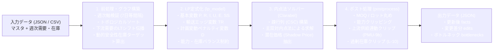

# scm-lp-optimizer

**Pure-Rust Multi-Period Capacitated Linear Programming (LP) Supply Chain Optimizer**  
マルチ期間・能力制約付きサプライチェーン計画（S&OP / 需給計画 / MRP展開）のための、Pure Rust 製・線形計画（LP）最適化エンジンです。

---

## 概要 (Overview)

`scm-lp-optimizer` は、複数拠点（工場・DC・サプライヤー）・多段階BOM（部品表）・輸送リードタイム・製造ライン能力・保管倉庫能力・安全在庫目標を考慮し、**総サプライチェーンコスト最小化（または利益最大化）** を行う汎用LP最適化エンジンです。

- **Pure Rust & C/C++依存ゼロ**: 内点法ソルバー [`clarabel`](https://crates.io/crates/clarabel) を採用。OS固有のC/C++共有ライブラリ（CBC / GLPK / HiGHS C-API 等）に依存せず、単一バイナリとしてビルド・配布可能です。
- **2つの実行モード**:
  1. **スタンドアロン CLI (`scm-lp-cli`)**: JSON ファイル（または標準入出力）を受け取り、最適化された計画と差分 (`edits`)、ボトルネックのシャドウプライス (`bottlenecks`) を JSON 出力します。
  2. **ステートレス REST API サーバー (`scm-lp-server`)**: Google Cloud Run 等のサーバーレスコンテナ環境向けに設計された高速な HTTP マイクロサービス（`GET /health`, `POST /optimize`）。
- **実務に即したポスト処理パイプライン**:
  - 連続LP解の最小ロットサイズ（MOQ）・刻みロット（Lot Size）への丸め上げ
  - 製造ライン・拠点能力上限による優先度付きクリッピング（利益マージン順）
  - 上流供給実績に連動した下流輸送入荷クリッピング（PMU-9b）
  - 安全在庫バッファ上限に基づく過剰生産クリッピング（L-10）

---

## アーキテクチャと処理フロー (Architecture)



---

## ディレクトリ構成 (Repository Structure)

```text
scm-lp-optimizer/
├── Cargo.toml                         # Rust パッケージ定義
├── Dockerfile                         # Google Cloud Run 用マルチステージ Dockerfile
├── README.md                          # 本ドキュメント
├── src/
│   ├── lib.rs                         # ライブラリエントリポイント (run_optimization)
│   ├── schema.rs                      # 入出力 JSON データモデル (Serde 構造体)
│   ├── lookups.rs                     # マスタ辞書構築・ロット丸め・能力カレンダー展開
│   ├── graph.rs                       # トポロジカル順序・需要伝播・安全在庫目標・入荷バケット化
│   ├── lp_model.rs                    # LP変数・目的関数・等式/不等式制約の構築
│   ├── solver_clarabel.rs             # Clarabel CSC疎行列変換・求解・双対変数抽出
│   ├── postprocess.rs                 # ロット丸め後の能力/供給/過剰在庫クリッピング・結果書き戻し
│   └── bin/
│       ├── cli.rs                     # CLI バイナリ (scm-lp-cli)
│       └── server.rs                  # HTTP REST サーバーバイナリ (scm-lp-server)
├── docs/
│   ├── mathematical_formulation.md    # 数理最適化モデル・定式化・ポスト処理の詳細解説
│   ├── data_dictionary.md             # 入出力マスタ・トランザクション全項目リファレンス
│   └── cloud_run_deployment.md        # Cloud Run デプロイ手順・Python連携ガイド
├── examples/
│   ├── basic_2echelon_request.json    # サンプル入力（原材料調達 -> 工場製造 -> DC輸送の4週間計画）
│   └── basic_2echelon_response.json   # サンプル出力（上記サンプルの最適化結果）
├── templates/
│   ├── request_template.json          # 全項目入りの JSON 入力テンプレート
│   ├── csv_to_json.py                 # CSV群から入力JSONを生成する変換スクリプト（標準ライブラリのみ）
│   └── csv/                           # 表計算ソフト (Excel等) 用の CSV 入力テンプレート一式
│       ├── config.json
│       ├── facts.csv
│       ├── lines.csv
│       ├── bom.csv
│       ├── transport_routes.csv
│       ├── item_locations.csv
│       ├── locations.csv
│       ├── init_inventory.csv
│       ├── scheduled_receipts.csv
│       └── capacity_overrides.csv
└── tests/
    └── golden_test.rs                 # 統合テストスイート
```

---

## クイックスタート (Quick Start)

### 前提条件
- Rust 1.80 以上（`rustup` 経由でのインストールを推奨）

### 1. ビルドとテストの実行

```bash
cargo test
cargo build --release
```

### 2. CLI モードでのサンプル実行 (`scm-lp-cli`)

同梱されている2段階サプライチェーン（工場 `PLANT-A` で原材料 `RAW-1` から完成品 `FG-1` を製造し、配送センター `DC-EAST` へ輸送リードタイム1週間で補充するモデル）を最適化します。

```bash
# ファイル指定で実行
cargo run --release --bin scm-lp-cli -- \
  --input examples/basic_2echelon_request.json \
  --output examples/basic_2echelon_response.json

# 標準入力・標準出力パイプラインで実行
cat examples/basic_2echelon_request.json | cargo run --release --bin scm-lp-cli
```

### 3. CSV テンプレートから JSON を作成して実行する

Excel やスプレッドシートで `templates/csv/` 内の CSV ファイルを編集し、Python スクリプトで JSON に変換して実行できます（外部ライブラリ不要）。

```bash
python templates/csv_to_json.py --csv-dir templates/csv --output my_request.json
cargo run --release --bin scm-lp-cli -- --input my_request.json --output my_response.json
```

### 4. REST API サーバーとして起動 (`scm-lp-server`)

```bash
# デフォルトポート 8080 で起動（環境変数 PORT で変更可能）
cargo run --release --bin scm-lp-server
```

別ターミナルから `curl` で動作確認できます：

```bash
# ヘルスチェック
curl http://localhost:8080/health

# 最適化リクエスト送信
curl -X POST http://localhost:8080/optimize \
  -H "Content-Type: application/json" \
  -d @examples/basic_2echelon_request.json
```

---

## 詳細ドキュメント (Documentation)

| ドキュメント | 内容 |
| :--- | :--- |
| [数理モデル・アルゴリズム解説 (`docs/mathematical_formulation.md`)](docs/mathematical_formulation.md) | LPの決定変数、目的関数、在庫・BOM・輸送・能力制約の数式定義、およびポスト処理アルゴリズムの詳細 |
| [データ辞書・スキーマ定義 (`docs/data_dictionary.md`)](docs/data_dictionary.md) | 入力マスタ・トランザクション・設定パラメータおよび出力JSONの全フィールド仕様 |
| [Cloud Run デプロイ・外部連携ガイド (`docs/cloud_run_deployment.md`)](docs/cloud_run_deployment.md) | Docker コンテナビルド、Google Cloud Run へのデプロイ手順、Python クライアントからの呼び出し実装例 |

---

## ライセンス (License)

MIT OR Apache-2.0
